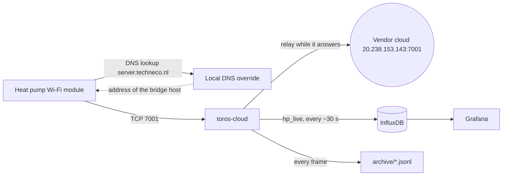

# toros-cloud operations

toros-cloud stands in for the cloud server that a Toros Vision heat pump's Wi-Fi module reports to. It gives the heat pump a live feed into InfluxDB and keeps the module reporting if the vendor's cloud service is ever discontinued.

## How it works



- Before each connection the module looks up `server.techneco.nl`. Override that name in your local DNS (router, dnsmasq, Pi-hole and so on) so it resolves to the host running toros-cloud. The module's traffic must be able to reach TCP 7001 on that host.
- The bridge relays to the vendor's IP address (`20.238.153.143:7001`), which is hard-coded so the DNS override does not loop back to itself. It copies every frame. If the vendor does not accept the connection within `connect_timeout` seconds (10 by default), it acknowledges the module itself (mode `auto`).
- The protocol is unencrypted. Frames start with `a5`, then sequence, type, payload length (2 bytes LE), payload and a 16-bit byte sum (LE). Type `0x30` frames hold 7-byte records (id, signed value). The vendor answers each with a 7-byte ack `a5 <seq> 01 00 00 <sum>`. The decoder is in `toros_cloud/cloud.py`.

## Deployment layout

| Item | Details |
|---|---|
| Compose project | `deploy/cloud/`: `docker-compose.yml` and `config.toml` (copied from `config.example.toml`) |
| Image | `toros-cloud:local`, built from this repository |
| Port | 7001/tcp. Set `[cloud] allow` to the module's IP address |
| Networks | The compose file uses its default network. To reach an InfluxDB container on another Docker network, attach that network to the service, or point `influx_url` at a host address |
| Data | InfluxDB database from `influx_db`, measurement `hp_live` (all fields float) |
| Archive | `data/archive/cloud-YYYY-MM-DD.jsonl`, every frame in both directions (`up`, `down`, `local`), about 0.5 MB a day. It contains the module's MAC address and is not rotated |
| DNS | Local override of `server.techneco.nl` to the bridge host |
| Dashboard | `grafana/toros-heatpump.dashboard.json`: live temperatures, fault code, runtimes and starts, energy counters, operating state |

## hp_live fields

### Live temperatures and status (63-byte frames every ~30 s, 98-byte frames every ~2 min)

The 63-byte frames carry `tvi_c`, `tvu_c`, `fvd_hz`, `monitor_state` and the lockout flag. The 98-byte frames, about every 2 minutes, carry the condenser temperatures `tci_c`, `tcu_c` and `tau_c`, the outdoor, room and hot water temperatures and the setpoints. Align the two rates when computing a ΔT.

| Field | Meaning | Record id | Scaling / unit |
|---|---|---|---|
| `tbu_c` | outdoor temperature (Tbu) | 18 | ×0.1 °C |
| `ttw_c` | domestic hot water cylinder (Ttw) | 188 | ×0.1 °C |
| `room_c` | room temperature from thermostat | 187 | ×0.1 °C |
| `ot_room_setpoint_c` | room setpoint from thermostat (OTRoomSetpoint) | 279 | ×0.1 °C |
| `tci_c` | return water into condenser (Tci) | 4 | ×0.1 °C |
| `tcu_c` | flow water leaving condenser (Tcu) | 5 | ×0.1 °C |
| `tau_c` | flow water leaving after electric element (Tau) | 6 | ×0.1 °C |
| `tvi_c` | brine ground loop inlet into evaporator (Tvi) | 2 | ×0.1 °C |
| `tvu_c` | brine ground loop outlet from evaporator (Tvu) | 3 | ×0.1 °C |
| `tbr_c` | source return temperature (Tbr, floating if disconnected) | 189 | ×0.1 °C |
| `tzc_solar_c` | solar collector temperature (TZC, 196.8 °C if open) | 241 | ×0.1 °C |
| `tmg_c` | mixing group temperature (Tmg, floating if disconnected) | 251 | ×0.1 °C |
| `control_value_c` | active control setpoint (Actuele regelwaarde) | 192 | ×0.1 °C |
| `fvd_hz` | evaporator flow sensor frequency | 7 | Hz |
| `fault` | actual error code (0 = none) | 1 | integer |
| `lockout_error` | lockout error state (1 = locked out, manual reset needed) | 32 | boolean |
| `distribution_state` | distribution valve/switch state | 190 | integer |
| `monitor_state` | heat pump operating state bitfield (1 = standby) | 235 | bitfield |
| `fw_crc` | controller firmware CRC code (CRC LuP), constant | 237 | integer |
| `frame_time` | Unix timestamp inside frame header | header | seconds |
| `compressor_on`, `dhw_on`, `heat_on`, `element_on` | derived from `monitor_state` (bit 1024 compressor, 4 hot water, 16 heating, 2048 element) | derived | 0 or 1 |

What is written to InfluxDB (the archive keeps every frame):

- Open-circuit sensors (ids 189, 241, 251: `tbr_c`, `tzc_solar_c`, `tmg_c`) and unknown ids that read 0 are not stored. Ids 10, 12 and 14 always are, so an electric element run shows up.
- Records whose id has bit 16 set are skipped. The flag means "no valid value": across 23 Oct to 26 Nov 2026 all 2,314 flagged records read 0, including 72 for the flow sensor (id 7, arriving as 65543) while the compressor ran and the unflagged reading was about 51 Hz, and one for the firmware CRC (id 237 as 65773, normally 2205).
- A ×0.1 °C reading of raw 32767 or -32768 is skipped (the room temperature read 32767 right after a module boot).
- Nothing is stored from frames whose header time is 0 or `0xFFFFFFFF`. The module sends these after it boots, before it asks for the time, and their values are placeholders (setpoint 0, distribution state 0, control value 0). On 26 Nov 2026 six such frames arrived within 3 seconds.

On the author's deployment the older fields of these names were also removed from the measurement.

Records 189, 241 and 251 read as implausible values (for example -62 °C, 196.8 °C or thousands of °C) when the sensor is not installed. These are open-circuit readings, not temperatures. Ignore them in graphs.

### Cumulative counters and runtimes (133-byte frames, about every 30 min)

| Field | Meaning | Record id | Notes |
|---|---|---|---|
| `hours_compressor_total` | Total compressor operating hours | 224 | Cumulative hours |
| `hours_heating_compressor` | Space heating compressor run hours (Actief CV) | 220 | Cumulative hours |
| `hours_dhw` | Hot water compressor run hours (was `hours_cooling_passive`, see below) | 197 | Cumulative hours |
| `starts_heating_compressor` | Space heating compressor starts (Actief CV) | 221 | Cumulative integer |
| `starts_dhw_compressor` | Domestic hot water compressor starts (Actief tap) | 198 | Cumulative integer |
| `starts_cooling_passive` | Passive cooling cycle starts (Passief koel) | 225 | Cumulative integer |
| `kwh_standby` | Standby electrical energy counter | 8 | 8-bit counter, wraps at 256 |
| `kwh_dhw` | Hot water electrical energy counter (was `kwh_heating_compressor`) | 9 | 8-bit counter, wraps at 256 |
| `kwh_heating` | Space heating electrical energy counter (was `kwh_dhw_compressor`) | 11 | 8-bit counter, wraps at 256 |
| `kwh_cooling_passive` | Passive cooling electrical energy counter | 13 | 8-bit counter, wraps at 256 |

Unused or zero-valued modes on a typical installation (emergency heating, electric heating elements, active cooling) correspond to the remaining ids 10, 12, 14, 184–186, 196, 199–201, 219, 222–223, 226–233 and 248–252.

## Electrical power and energy

### Energy counters (records 8 to 14)

The controller's own lifetime energy counters. Each is a single byte (0 to 255 kWh) and wraps every 256 kWh. They arrive in the 133-byte frames, so the resolution is 1 kWh per step.

| Record id | Controller register | hp_live field | Mode |
|:---:|---|---|---|
| 8 | `Standby_kWh` | `kwh_standby` | Standby consumption |
| 9 | (map says `Actief_CV_kWh`) | `kwh_dhw` | Hot water with the compressor (observed) |
| 10 | `EE_CV_kWh` | not mapped | Electric element, space heating |
| 11 | (map says `Actief_tap_kWh`) | `kwh_heating` | Space heating with the compressor (by elimination) |
| 12 | `EE_tap_kWh` | not mapped | Electric element, hot water |
| 13 | `Passief_koel_kWh` | `kwh_cooling_passive` | Passive cooling (pumps) |
| 14 | `Actief_koel_kWh` | not mapped | Active cooling with the compressor |

When graphing these, handle the wrap at 256. `non_negative_difference` drops the step across a wrap. The dashboard's kWh tiles instead take hourly differences, count a step of -255 to -236 as a wrap (+256) and ignore any step outside 0 to 20 kWh as a bad reading (see `grafana/toros-heatpump.dashboard.json`, panels 30 to 33).

**Relabelled 2026-10-24.** The community register map's labels for records 9, 11 and 197 do not match this unit. During a hot-water-only run on 2026-10-23 (16:44 to 18:07 UTC: setpoint 60 °C, distribution state 7, cylinder 50.7 to 55.2 °C, heating hours and starts unchanged), record 198 (hot water starts) stepped at the start, and records 9 and 197 each stepped by 1 at 17:32; record 11 did not move. Their rise since the last vendor export (Feb 2026) agrees: record 197 +505 h against about 490 h of hot water a year, record 9 +473 kWh (one wrap) against about 506 kWh predicted. Record 11 as heating was confirmed on 2026-11-07: a 390-minute heating run (state 1040) stepped record 11 three times and record 220 four times, and record 9 did not move. Record 224 stayed constant through the 83-minute run, so it is not a running hour counter. Before 2026-10-24 the same values are stored under the old names too (backfilled under the new names, old fields kept).

### Runtime counters as a power proxy

The hour counters (records 197 and 220) do not wrap. On this unit (23 Oct to 11 Nov 2026, from `monitor_state` at 30 s resolution) hot water used about 1.0 kWh per compressor hour (39 kWh over 38.4 h) and heating about 1.1 kWh per hour (30 kWh over 27.2 h); the vendor export year gave 0.76 and 1.0. Earlier text here said 3.3 kW per run hour, which does not fit this unit. Record 224 never moved (4,119) and is not a run-hour counter. The standby counter (record 8) stayed at 127 for 20 days, where about 4 W would have added about 2 kWh, so it may be stuck.

Per-run energy: `compressor_on`, `dhw_on` and `heat_on` are written every 30 s, so run minutes are known to 30 s. Multiply by the kWh-per-hour figures above; the 1 kWh counters only confirm the totals.

### Cross-checking a mapping

A counter's meaning can be checked by dividing its change by the change in the matching run-hour counter over the same period, then comparing the result with the unit's electrical rating. Where an 8-bit counter wrapped in between, add 256 to the difference.

## OpenTherm Gateway (OTGW) notes

From the OTGW project (otgw.tclcode.com) and community discussion.

- The Toros Vision answers 35 standard OpenTherm message ids, including diagnostics, the fault buffer and temperature telemetry.
- Burner starts and hours (ids 116 to 124) are not supported, because the unit has a compressor and no burner.
- A standard OpenTherm boiler modulates on the control setpoint (data id 1). The Toros Vision ignores id 1 and works out its own flow target from the heating curve plus room compensation:

```text
target = stooklijn(T_outdoor) + k * (ID16 - 20) + 0.1 * f * (ID16 - ID24)
```

  `stooklijn` is the heating curve, ID16 is the room setpoint and ID24 the room temperature. `k` and `f` are compensation factors in the controller; their values have not been determined.
- OTGW commands `BS=<temp>` (override the room setpoint, id 16) and `RT=<temp>` (override the room temperature, id 24) shift the curve result and can start or suppress compressor runs. Neither writes to the EEPROM.
- `SW=<temp>` sets the hot water setpoint and `HW=P` triggers a single hot water heating run.

## Operations

Run these from `deploy/cloud/`.

- Is it alive: the "Last data from heat pump" stat on the dashboard should say under a minute ago. Or: `docker compose logs --tail 20 toros-cloud`.
- Normal log lines: `listening on ...`; occasionally `upstream ... unreachable (TimeoutError()); answering <module IP> locally` (vendor slow). Repeated `refused connection` means a device that is not in `[cloud] allow` is reaching port 7001.
- Restart: `docker compose restart`.
- Update the code: pull or copy the new source, then `docker compose build && docker compose up -d`.
- Roll back to the vendor cloud only: remove the DNS override, clear the DNS cache on your resolver, then stop the container. The module goes straight to the vendor again.
- After a vendor shutdown nothing needs to change: `auto` answers locally. Check that `hp_live` keeps growing and that the archive shows `local` acks.

## Frames other than data

Besides the `0x30` data frames the module and the vendor exchange:

| Frame | Direction | Content |
|---|---|---|
| `0x12` hello, 35 bytes | module to server, about every 10 s (a new TCP connection each time) | firmware string `00.06` and the MAC. Never answered |
| `0x17`, 7 bytes | module to server, occasionally | time request. The server answers type 1 with a 4-byte LE Unix time |
| `0x20` query, 8 bytes, payload `00` or `01` | module to server, about every 10 min | the server answers payload `00` with a type 1 frame (20 bytes, constant for 20 days: module configuration, unknown meaning) and payload `01` with a type 2 frame holding `02` |

The replies to `0x20` queries did not change from 23 Oct to 26 Nov 2026. The bridge gets them from three places, later ones overriding earlier ones:

1. Built in: the reply to `20:01` (type 2, payload `02`). The reply to `20:00` is not built in, because its payload is specific to the module (it contains the 4-byte id from the data frame headers).
2. `[cloud.replies]` in `config.toml`, for example `"20:00" = "01:<40 hex digits>"`. Copy the value from `learned_replies.json` so that standalone mode keeps working if that file is lost. Keep it out of public repositories.
3. Learned: in `auto` and `relay` mode the bridge stores the server's replies in `learned_replies.json` in the archive directory.

A reply is matched to its query by sequence number within the same TCP connection only. It is accepted, from any of the three sources, only if it has a payload and, for `20:00` and `20:01`, the observed frame type and payload size (type 1 with 20 bytes, type 2 with 1 byte). The learned file is written atomically and checked on load: malformed entries are ignored, and an unreadable file is ignored as a whole.

Before this check, an unanswered query on one connection could match a later data ack with the same sequence number, so the stored reply to `20:00` alternated between the configuration frame and an empty ack.

When the vendor does not answer, or in `standalone` mode, the bridge answers locally: the 7-byte ack for data frames, the current time for `0x17`, and the known reply for `0x20`. Hellos get no reply, as with the vendor. A query with no known reply is logged and counted as `unanswered`. Standalone behaviour is covered by unit tests only; it has not been run against the module.

### Bridge metric `hp_bridge`

Once a minute, counts since the previous point (the first point is written one minute after the bridge starts): `connections`, `hello`, `time_requests`, `queries`, `local_replies` (frames the bridge answered itself), `upstream_failures` (vendor did not accept the connection) and `unanswered`. `hello` per minute is a heartbeat for the module; `local_replies` and `upstream_failures` show the vendor getting slow or going away. Configure the measurement name with `[cloud] bridge_measurement` (default `hp_bridge`, empty disables it).

## Risks and limits

- **Depends on the DNS override.** If the override stops applying (for example a device or resolver ignores local DNS, or the cache expires with the wrong answer), the module talks to the vendor directly and `hp_live` stops. The dashboard's "Last data" stat shows this.
- **Unknown server messages.** Over 20 days the vendor sent only the ack, the time reply and the two query replies above. Standalone mode reproduces all of them, but whether the module is happy with the repeated configuration reply and a local clock is untested.
- InfluxDB writes are unauthenticated. Keep the database on a trusted network or adapt the writer.
- Once standalone, the vendor's engineers lose remote access to the unit.
- The archive grows by about 0.5 MB a day. Prune old files by hand if needed.
