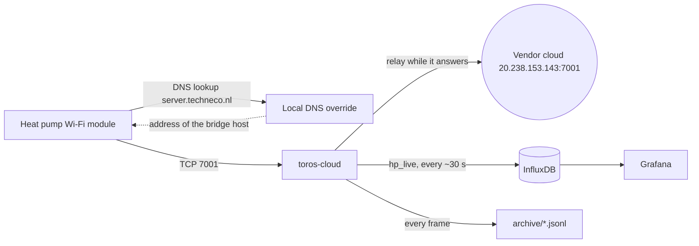

# toros-cloud operations

toros-cloud stands in for the cloud server that a Toros Vision heat pump's Wi-Fi module reports to. It gives the heat pump a live feed into InfluxDB and keeps the module reporting if the vendor's cloud service is ever discontinued.

## How it works



- Before each connection the module looks up `server.techneco.nl`. Override that name in your local DNS (router, dnsmasq, Pi-hole and so on) so it resolves to the host running toros-cloud. The module's traffic must be able to reach TCP 7001 on that host.
- The bridge relays to the vendor's IP address (`20.238.153.143:7001`), which is hard-coded so the DNS override does not loop back to itself. It copies every frame. If the vendor does not accept the connection within `connect_timeout` seconds (10 by default), it acknowledges the module itself (mode `auto`).
- The protocol is unencrypted. Frames start with `a5`, then sequence, type, payload length (2 bytes LE), payload and a 16-bit byte sum (LE). Type `0x30` frames hold 7-byte records (id, signed value). The vendor answers each with a 7-byte ack `a5 <seq> 01 00 00 <sum>`. The decoder is in `toros_cloud/cloud.py`.

## Deployment layout

| Item | Details |
|---|---|
| Compose project | `deploy/cloud/`: `docker-compose.yml` and `config.toml` (copied from `config.example.toml`) |
| Image | `toros-cloud:local`, built from this repository |
| Port | 7001/tcp. Set `[cloud] allow` to the module's IP address |
| Networks | The compose file uses its default network. To reach an InfluxDB container on another Docker network, attach that network to the service, or point `influx_url` at a host address |
| Data | InfluxDB database from `influx_db`, measurement `hp_live` (all fields float) |
| Archive | `data/archive/cloud-YYYY-MM-DD.jsonl`, every frame in both directions (`up`, `down`, `local`), about 0.5 MB a day. It contains the module's MAC address and is not rotated |
| DNS | Local override of `server.techneco.nl` to the bridge host |
| Dashboard | `grafana/toros-heatpump.dashboard.json`: live temperatures, fault code, runtimes and starts, energy counters, operating state |

## hp_live fields

### Live temperatures and status (98-byte and 63-byte frames, about every 30 s)

| Field | Meaning | Record id | Scaling / unit |
|---|---|---|---|
| `tbu_c` | outdoor temperature (Tbu) | 18 | ×0.1 °C |
| `ttw_c` | domestic hot water cylinder (Ttw) | 188 | ×0.1 °C |
| `room_c` | room temperature from thermostat | 187 | ×0.1 °C |
| `ot_room_setpoint_c` | room setpoint from thermostat (OTRoomSetpoint) | 279 | ×0.1 °C |
| `tci_c` | return water into condenser (Tci) | 4 | ×0.1 °C |
| `tcu_c` | flow water leaving condenser (Tcu) | 5 | ×0.1 °C |
| `tau_c` | flow water leaving after electric element (Tau) | 6 | ×0.1 °C |
| `tvi_c` | brine ground loop inlet into evaporator (Tvi) | 2 | ×0.1 °C |
| `tvu_c` | brine ground loop outlet from evaporator (Tvu) | 3 | ×0.1 °C |
| `tbr_c` | source return temperature (Tbr, floating if disconnected) | 189 | ×0.1 °C |
| `tzc_solar_c` | solar collector temperature (TZC, 196.8 °C if open) | 241 | ×0.1 °C |
| `tmg_c` | mixing group temperature (Tmg, floating if disconnected) | 251 | ×0.1 °C |
| `control_value_c` | active control setpoint (Actuele regelwaarde) | 192 | ×0.1 °C |
| `fvd_hz` | evaporator flow sensor frequency | 7 | Hz |
| `fault` | actual error code (0 = none) | 1 | integer |
| `lockout_error` | lockout error state (1 = locked out, manual reset needed) | 32 | boolean |
| `distribution_state` | distribution valve/switch state | 190 | integer |
| `monitor_state` | heat pump operating state bitfield (1 = standby) | 235 | bitfield |
| `fw_crc` | controller firmware CRC code (CRC LuP), constant | 237 | integer |
| `frame_time` | Unix timestamp inside frame header | header | seconds |

Records 189, 241 and 251 read as implausible values (for example -62 °C, 196.8 °C or thousands of °C) when the sensor is not installed. These are open-circuit readings, not temperatures. Ignore them in graphs.

### Cumulative counters and runtimes (133-byte frames, about every 30 min)

| Field | Meaning | Record id | Notes |
|---|---|---|---|
| `hours_compressor_total` | Total compressor operating hours | 224 | Cumulative hours |
| `hours_heating_compressor` | Space heating compressor run hours (Actief CV) | 220 | Cumulative hours |
| `hours_cooling_passive` | Passive cooling run hours (Passief koel uren) | 197 | Cumulative hours |
| `starts_heating_compressor` | Space heating compressor starts (Actief CV) | 221 | Cumulative integer |
| `starts_dhw_compressor` | Domestic hot water compressor starts (Actief tap) | 198 | Cumulative integer |
| `starts_cooling_passive` | Passive cooling cycle starts (Passief koel) | 225 | Cumulative integer |
| `kwh_standby` | Standby electrical energy counter | 8 | 8-bit counter, wraps at 256 |
| `kwh_heating_compressor` | Space heating electrical energy counter | 9 | 8-bit counter, wraps at 256 |
| `kwh_dhw_compressor` | Hot water electrical energy counter | 11 | 8-bit counter, wraps at 256 |
| `kwh_cooling_passive` | Passive cooling electrical energy counter | 13 | 8-bit counter, wraps at 256 |

Unused or zero-valued modes on a typical installation (emergency heating, electric heating elements, active cooling) correspond to the remaining ids 10, 12, 14, 184–186, 196, 199–201, 219, 222–223, 226–233 and 248–252.

## Electrical power and energy

### Energy counters (records 8 to 14)

The controller's own lifetime energy counters. Each is a single byte (0 to 255 kWh) and wraps every 256 kWh. They arrive in the 133-byte frames, so the resolution is 1 kWh per step.

| Record id | Controller register | hp_live field | Mode |
|:---:|---|---|---|
| 8 | `Standby_kWh` | `kwh_standby` | Standby consumption |
| 9 | `Actief_CV_kWh` | `kwh_heating_compressor` | Space heating with the compressor |
| 10 | `EE_CV_kWh` | not mapped | Electric element, space heating |
| 11 | `Actief_tap_kWh` | `kwh_dhw_compressor` | Hot water with the compressor |
| 12 | `EE_tap_kWh` | not mapped | Electric element, hot water |
| 13 | `Passief_koel_kWh` | `kwh_cooling_passive` | Passive cooling (pumps) |
| 14 | `Actief_koel_kWh` | not mapped | Active cooling with the compressor |

When graphing these, handle the wrap at 256, for example with `non_negative_derivative`, or by unwrapping in the query.

### Runtime counters as a power proxy

The hour counters (records 224, 220 and 197) do not wrap. Compared against a vendor metrics export from a Toros Vision TVPT 2, the heating counter gained about 3.3 kW per run hour, which matches the unit's 3.3 kW single-phase compressor. The standby counter averaged about 4 W. Multiplying run hours by the rated compressor power therefore approximates energy over longer periods.

### Cross-checking a mapping

A counter's meaning can be checked by dividing its change by the change in the matching run-hour counter over the same period, then comparing the result with the unit's electrical rating. Where an 8-bit counter wrapped in between, add 256 to the difference.

## OpenTherm Gateway (OTGW) notes

From the OTGW project (otgw.tclcode.com) and community discussion.

- The Toros Vision answers 35 standard OpenTherm message ids, including diagnostics, the fault buffer and temperature telemetry.
- Burner starts and hours (ids 116 to 124) are not supported, because the unit has a compressor and no burner.
- A standard OpenTherm boiler modulates on the control setpoint (data id 1). The Toros Vision ignores id 1 and works out its own flow target from the heating curve plus room compensation:

```text
target = stooklijn(T_outdoor) + k * (ID16 - 20) + 0.1 * f * (ID16 - ID24)
```

  `stooklijn` is the heating curve, ID16 is the room setpoint and ID24 the room temperature. `k` and `f` are compensation factors in the controller; their values have not been determined.
- OTGW commands `BS=<temp>` (override the room setpoint, id 16) and `RT=<temp>` (override the room temperature, id 24) shift the curve result and can start or suppress compressor runs. Neither writes to the EEPROM.
- `SW=<temp>` sets the hot water setpoint and `HW=P` triggers a single hot water heating run.

## Operations

Run these from `deploy/cloud/`.

- Is it alive: the "Last data from heat pump" stat on the dashboard should say under a minute ago. Or: `docker compose logs --tail 20 toros-cloud`.
- Normal log lines: `listening on ...`; occasionally `upstream ... unreachable (TimeoutError()); answering <module IP> locally` (vendor slow). Repeated `refused connection` means a device that is not in `[cloud] allow` is reaching port 7001.
- Restart: `docker compose restart`.
- Update the code: pull or copy the new source, then `docker compose build && docker compose up -d`.
- Roll back to the vendor cloud only: remove the DNS override, clear the DNS cache on your resolver, then stop the container. The module goes straight to the vendor again.
- After a vendor shutdown nothing needs to change: `auto` answers locally. Check that `hp_live` keeps growing and that the archive shows `local` acks.

## Risks and limits

- **Depends on the DNS override.** If the override stops applying (for example a device or resolver ignores local DNS, or the cache expires with the wrong answer), the module talks to the vendor directly and `hp_live` stops. The dashboard's "Last data" stat shows this.
- **Unknown server messages.** Only the 7-byte ack has been seen from the vendor. If the vendor sends anything else the module needs (time, commands), standalone mode will not reproduce it. The archive records every downstream frame so this can be checked.
- InfluxDB writes are unauthenticated. Keep the database on a trusted network or adapt the writer.
- Once standalone, the vendor's engineers lose remote access to the unit.
- The archive grows by about 0.5 MB a day. Prune old files by hand if needed.
